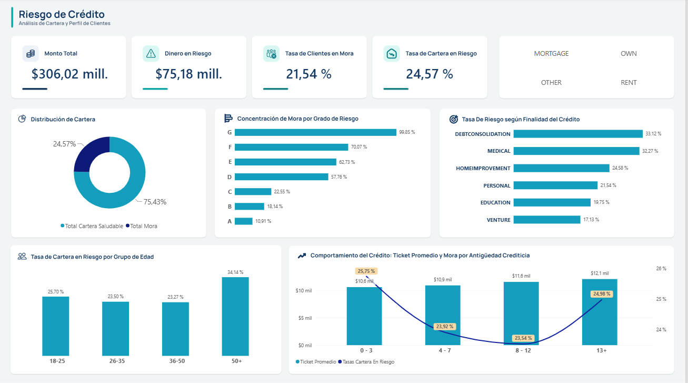
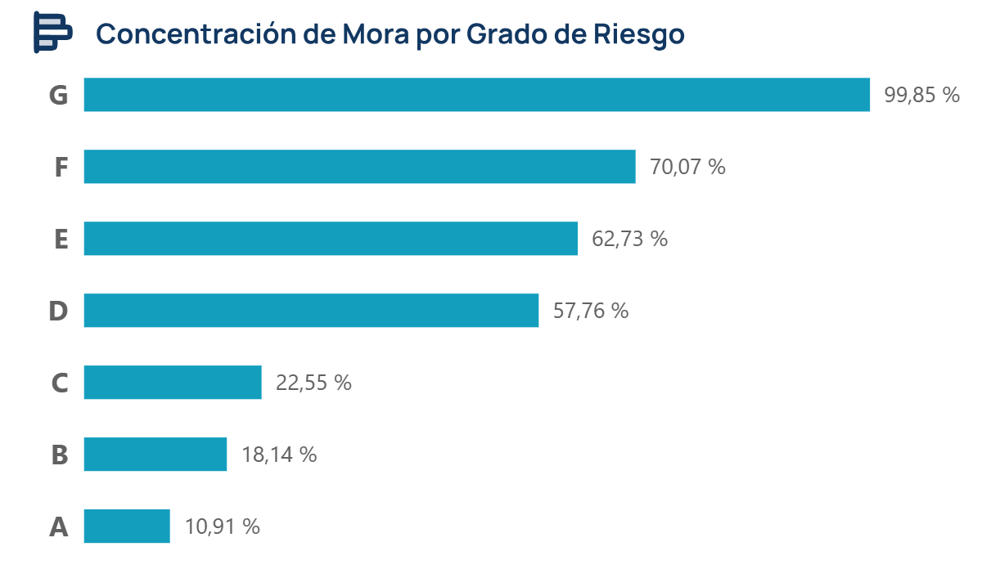
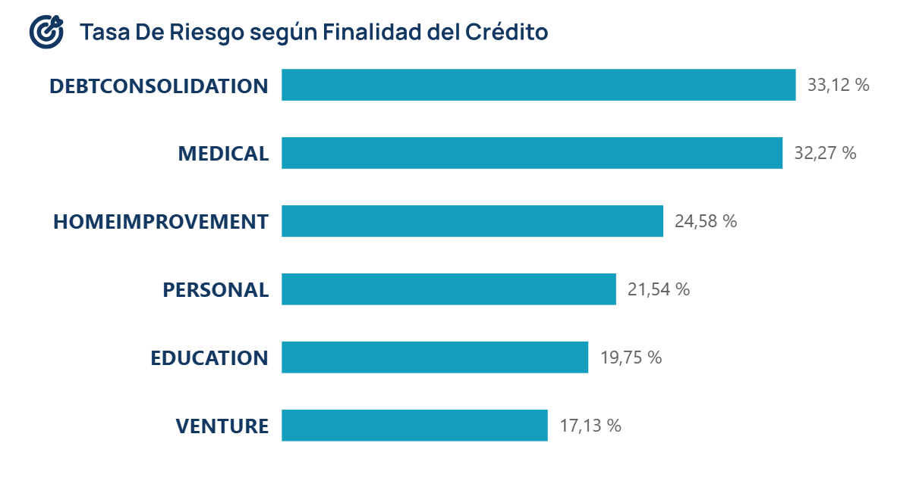
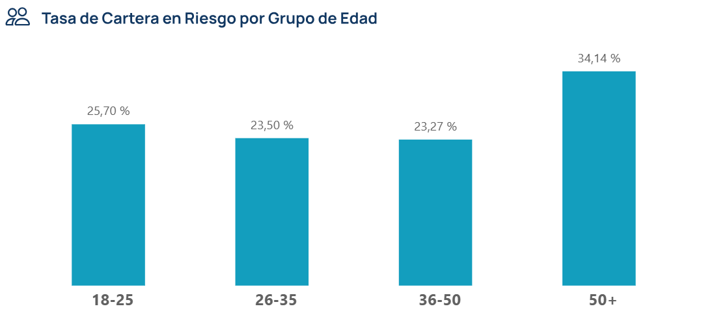
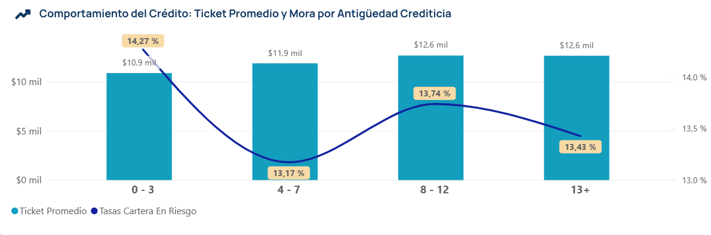

# Análisis y Gestión del Riesgo Crediticio

## Resumen ejecutivo

Este proyecto simula un flujo de trabajo analítico para la gestión y evaluación del riesgo crediticio. Su objetivo principal es transformar datos transaccionales brutos en métricas financieras clave para evaluar la exposición al riestgo de la cartera, identificar segmentos vulnerables y optimizar la toma de decisiones estratégicas.

La solución cubre un enfoque end-to-end: **Data Engineering / Automatización** (PostgreSQL + Python), **Business Intelligence & Modelado DAX** (Power BI), y **Análisis Exploratorio de Negocio**.

## Arquitectura de la Solución

- **Base de Datos:** PostgreSQL (Almacenamiento de la tabla central `credit_risk`)
- **Automatización y Pipeline (ETL):** Python (`SQLAlchemy`, `Pandas`) para la extracción y automatización de consultas SQL a CSVs estructurados.
- **Visualización y Dashboard:** Power BI, medidas DAX y diseño de interfaz ejecutiva.

## 📂 Estructura del Repositorio

```text
Proyecto_Credit_Risk/
│
├── dashboard/                              # Archivo .pbix del proyecto
│   ├── credit_risk_dashboard.pbix
│   └── Dashboard Template.svg
│
├── data/
│   ├── processed/
│   │   └── clean_credit_risk_dataset.csv   # Datos ya tratados y limpios
│   └── raw/
│       └── credit_risk_dataset.csv         # Datos sin limpiar (Dataset original)
│
├── notebooks/
│   └── 01_data_cleaning.ipynb              # Exploración inicial (EDA) y limpieza de datos
│
├── outputs/                                # Archivos CSVs gererados automaticamente
│   ├── 01_kpi_global.csv
│   ├── 02_loan_grade_risk.csv
│   ├── 03_vivienda_intent.csv
│   ├── 04_historial_credito.csv
│   └── 05_grupo_edad.csv
│
├── scripts/                                # Código de automatización en Python
│   └── fetch_risk_data.py
│
├── sql/
│   ├── risk_queries.sql                    # Consultas SQL analíticas para el cálculo de KPIs de riesgo
│   └── schema.sql                          # Definición de la estructura de tablas y esquemas en PostgreSQL
│
└── README.md                               # Documentación del proyecto
```

## 🚀 Guía de Inicio Rápido

### 1. Clonar o descargar el repositorio

```bash
git clone [https://github.com/tu-usuario/Proyecto_Credit_Risk.git](https://github.com/tu-usuario/Proyecto_Credit_Risk.git)
```

### 2. Exploración de Datos y Pipeline

- Datos limpios y procesados: Encuentra los datasets listos para análisis en la carpeta `outputs/`.

- Limpieza de datos: Revisa el cuaderno interactivo de Jupyter Notebook con todo el proceso de EDA en `notebooks/01_data_cleaning.ipynb`.

- Consultas SQL: Explora las consultas analíticas de métricas en `sql/risk_queries.sql`.

### 3. Visualizar el Dashboard (Power BI)

1. Abre Power BI Desktop.

2. Abre el archivo del tablero interactivo ubicado en `dashboard/credit_risk_dashboard.pbix`

## 🖼️ Vista Previa del Dashboard



## 📈 Principales Hallazgos e Insights de Negocio

A través del análisis integrado en Power BI y las consultas analíticas en SQL, se identificaron los siguientes patrones clave de comportamiento y exposición al riesgo dentro de la cartera crediticia:

### 1. Concentración del Riesgo por Calificación Crediticia (`loan_grade`)

- **Concentración crítica de la morosidad:** Si bien el volumen principal de la cartera se concentra en los grados de mayor calidad (A y B), el riesgo de impago escala de manera drástica y exponencial en los tramos inferiores (D, E, F y G). Destaca especialmente el segmento G, donde la tasa de mora roza el 98%, evidenciando que las altas tasas de interés de estos grados ya no son suficientes para compensar la pérdida de capital.
- **Diagnóstico del comportamiento de cartera:** Los niveles críticos de morosidad en los grados inferiores responden tanto a un posible fallo en los modelos predictivos de originación como al deterioro sobrevenido de la capacidad de pago de los clientes (motivado por sobreendeudamiento o shocks financieros imprevistos), lo que desplaza a prestatarios hacia categorías de altísimo riesgo.
- **Recomendación estratégica:** Endurecer de inmediato los filtros de originación y scoring crediticio para solicitudes ubicadas en las categorías D a G. Es indispensable restringir la exposición en estos segmentos, exigir colaterales adicionales o reevaluar la viabilidad de otorgar créditos donde la probabilidad de impago supera con creces el rendimiento financiero de la tasa de interés.



### 2. Vulnerabilidad por Finalidad del Préstamo (`loan_intent`)

- **Destinos de alto riesgo:** Los créditos solicitados para Consolidación de Deuda (`DEBTCONSOLIDATION`) y Gastos Médicos (`MEDICAL`) registran las tasas de morosidad más elevadas del segmento, alcanzando un 33,12% y un 32,27% respectivamente. En contraste, finalidades como el emprendimiento (`VENTURE`) o la educación (`EDUCATION`) muestran un comportamiento de pago considerablemente más estable (17,13% y 19,75%).
- **Recomendación estratégica:** Establecer límites de crédito iniciales más rigurosos y exigir planes de viabilidad operativa para créditos comerciales o de consolidación antes de su aprobación.



### 3. Comportamiento por Rango Etario y Antigüedad Crediticia

- **Vulnerabilidad en los extremos etarios:** La tasa de cartera en riesgo muestra un comportamiento bifocal, concentrándose de manera crítica en los prestatarios mayores de **50 años (34,14%)** y, en menor medida, en el segmento joven de **18 a 25 años (25,70%)**, superando a los grupos intermedios de 26 a 50 años que rondan el 23% de riesgo.
- **Efecto del historial crediticio:** Se observa una correlación estrecha entre la madurez financiera del cliente y su capacidad de cumplimiento, donde los perfiles en los extremos de edad exigen un monitoreo diferenciado (riesgo de ciclo de vida o ingresos fijos en adultos mayores frente a inexperiencia crediticia en jóvenes).
- **Recomendación estratégica:** Implementar políticas de originación segmentadas: endurecer la evaluación de capacidad de pago real para clientes del segmento sénior (50+) y diseñar productos de crédito progresivo (_line-increases_) para los prestatarios más jóvenes, incrementando el cupo disponible únicamente conforme demuestren un historial de pago puntual sostenido.



### 4. Comportamiento del Crédito: Ticket Promedio y Mora por Antigüedad Crediticia

- **Evolución del monto prestado:** Existe una correlación positiva y directa entre la antigüedad crediticia y el tamaño del préstamo. El ticket promedio escala progresivamente desde los **$10.9 mil** en perfiles nuevos (0-3 años) hasta estabilizarse en **$12.6 mil** para clientes con más de 8 años de trayectoria en el buró.
- **Comportamiento no lineal del riesgo:** La tasa de cartera en riesgo muestra un comportamiento dinámico: arranca alta en los primeros años (**14.27%** por inexperiencia), desciende a su nivel más óptimo en el rango de **4 a 7 años (13.17%)**, y experimenta un ligero repunte en el segmento de **8 a 12 años (13.74%)** antes de moderarse levemente a partir de los 13 años.
- **Recomendación estratégica:** Aprovechar la consolidación del cliente en la etapa intermedia (4-7 años) para otorgar ampliaciones de línea de crédito de forma segura, manteniendo al mismo tiempo controles de riesgo preventivos en carteras maduras de larga data para contener el repunte de mora en los tramos avanzados.



## 📌 Conclusiones y Hallazgos Principales

- **Concentración del Riesgo Crediticio:** El análisis confirma que la morosidad no se distribuye de manera uniforme; los grados de riesgo más bajos (D, E, F y G) concentran las tasas de incumplimiento más críticas, evidenciando que las tasas de interés elevadas en estos segmentos no logran mitigar la pérdida total de la cartera.
- **Impacto de la Finalidad del Crédito:** Los destinos enfocados en Consolidación de Deuda y Gastos Médicos representan las mayores vulnerabilidades para la cartera, superando el 32% de riesgo, lo que sugiere que los solicitantes con presiones financieras previas o emergencias tienen menor capacidad de pago.
- **Vulnerabilidad Demográfica y de Historial:** Se identificó un comportamiento de riesgo bifocal en los extremos etarios (jóvenes de 18-25 años y adultos mayores de 50+), así como una relación directa donde la inexperiencia o el historial muy corto aumentan la volatilidad del crédito.
- **Dinámica de la Antigüedad Crediticia:** El comportamiento del riesgo a lo largo del tiempo muestra que, aunque los montos prestados aumentan con la antigüedad del cliente, la morosidad experimenta fluctuaciones y un repunte en carteras maduras de mediano plazo (8-12 años), requiriendo un monitoreo constante.
